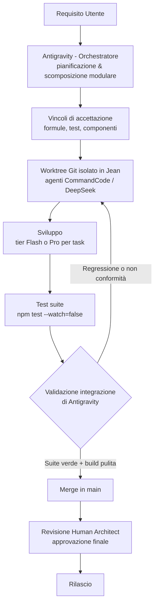

[🇬🇧 English Version](AGENT.md)

# Workflow Agentico Supervisionato & Architettura Ingegneristica

Questo documento descrive come **HeroForge-Anew-Angular** viene pianificato, implementato e
verificato. È il complemento del [README](README.it.md): il README spiega *cos'è* il progetto, questo
documento spiega *come* viene costruito.

---

## 1. Filosofia Fondamentale: Supervised AI Coding vs Vibe Coding

**Vibe coding** significa descrivere un risultato al modello, accettare il codice generato perché
*sembra* plausibile e pubblicarlo. Ottimizza la velocità di produzione. Non ottimizza la correttezza,
e non è in grado di distinguere tra "questo funziona" e "questo si legge come se funzionasse".

Questa distinzione è fatale per un progetto come un motore di regole di D&D 3.5. Tre modalità di
errore sono strutturali, non occasionali:

- **Mancanza di verificabilità.** Non esiste un compilatore o un sistema di tipi in grado di
  confermare che "il Bonus di Attacco Base per una progressione buona al livello 12 è +12". La
  correttezza vive nelle *regole*, e solo un oracolo esplicito — il foglio di calcolo originale e
  l'SRD — può confermarla.
- **Allucinazioni matematiche.** Un modello può emettere con sicurezza una formula plausibile ma
  errata (un off-by-one nella tabella dei costi del point buy, un moltiplicatore di capacità di carico
  sbagliato, una curva di esperienza scorretta). L'output è fluente e i numeri sono sbagliati — la
  combinazione peggiore possibile, perché sopravvive alla revisione superficiale.
- **Regressioni silenziose.** Una correzione a una capacità di classe può rompere in silenzio un
  calcolo condiviso da altre venti. Senza una suite di regressione, la rottura è invisibile finché un
  utente non nota un numero sbagliato sulla scheda del personaggio.

**Il Supervised AI Coding** è la disciplina opposta. L'AI scrive il codice, ma il processo attorno ad
esso è ingegnerizzato:

- **Un oracolo esplicito.** Ogni regola è verificata contro le formule originali di HeroForge Anew e
  l'SRD D&D 3.5, e codificata come test automatico. Le formule sono la specifica.
- **Una suite di test formale.** La suite di conformità
  (`frontend/src/app/core/services/character-rules-excel-compliance.spec.ts`) fissa i valori attesi —
  tabella dei costi del point buy, tabella dell'esperienza `L * (L - 1) / 2 * 1000`, progressioni del
  BAB, formule dei tiri salvezza base e altro — così la correttezza è verificata dalla macchina, non a
  occhio.
- **Revisione, non accettazione.** Il codice generato è rivisto rispetto ai vincoli prima di entrare in
  `main`. "Sembra a posto" non è un criterio di accettazione; "la suite è verde e la build è pulita"
  lo è.

Il risultato è che l'AI accelera l'esecuzione mentre gli umani mantengono il giudizio, e ogni numero
sulla scheda del personaggio è tracciabile a una formula che un test protegge.

---

## 2. L'Architettura Agentica Triadica

Il lavoro è svolto da tre ruoli con responsabilità nettamente separate:

### Human Architect

- Direzione strategica e requisiti di business.
- Definizione di cosa significa "fatto" per il prodotto.
- Validazione finale e approvazione. L'Human Architect è responsabile.

### Antigravity (Google DeepMind) — Orchestratore & Supervisore

- Pianificazione architetturale e **scomposizione modulare** del lavoro in task consegnabili in modo
  indipendente.
- Definizione dei **vincoli di accettazione** per ogni task (quali formule, quali componenti, quali
  test).
- Supervisione della disciplina di **test e integrazione**: verifica che la suite sia verde e che le
  modifiche rispettino le regole di conformità Excel/SRD prima di qualsiasi integrazione.
- Detiene la domanda "è questa la struttura giusta?" sull'intero sistema.

### Jean (Collabsio) — Motore di Esecuzione Agentica Distribuita

- Esegue i task come **agenti CommandCode in worktree Git isolati**, così i flussi di lavoro paralleli
  non entrano mai in conflitto sullo stesso albero di lavoro.
- Funziona su modelli **DeepSeek** con tiering:
  - **Tier Flash** per task ben circoscritti — documentazione, piccole feature, modifiche meccaniche.
  - **Tier Pro** per refactoring architetturali, modifiche trasversali e lavoro sul motore di regole,
    dove serve ragionamento più profondo.
- Produce le modifiche su un branch e le riconsegna per la validazione; non auto-approva mai un merge.

---

## 3. Diagramma del Flusso di Lavoro

Il ciclo completo, dal requisito utente alla modifica integrata, è:

Il ritorno dalla validazione al worktree è intenzionale: un test fallito o una violazione di conformità
rimanda la modifica allo sviluppo. Nulla raggiunge `main` con una suite rossa.

---

## 4. Standard Ingegneristici e Linee Guida per gli Agenti

Queste sono regole vincolanti per ogni agente che lavora su questo repository.

### Isolamento dei branch — mai lavorare su `main`

- Tutto il lavoro avviene su un branch dedicato (ad es. `docs/readme-and-agent`, `feat/...`,
  `fix/...`).
- `main` viene aggiornato solo tramite un merge rivisto. Non committare mai direttamente su `main`.

### Test-Driven e conformità Excel

- Ogni calcolo deve rispettare le formule del foglio HeroForge Anew originale e dell'SRD D&D 3.5. La
  nuova logica di regole si scrive test-first quando è possibile.
- La suite di conformità è l'oracolo per il comportamento numerico; modificare una formula significa
  modificare il suo test con giustificazione, non eliminarlo.

### Politica Zero-regressione

- `npm test -- --watch=false` deve riportare **100% pass — tutti i 130 test** — prima di ogni commit.
- Una suite rossa è una condizione bloccante, non un avviso. Correggi la regressione; non saltare né
  disabilitare il test.

### Build pulita

- `npm run build` deve completare senza errori prima che una modifica sia considerata consegnabile.
- Una modifica che rompe la build di produzione non è unibile, indipendentemente dallo stato dei test.

### Disciplina di ambito

- Modifica solo ciò che il task richiede. Non rifattorizzare codice non correlato, non aggiungere
  astrazioni speculative, non introdurre configurazione per bisogni futuri ipotetici.
