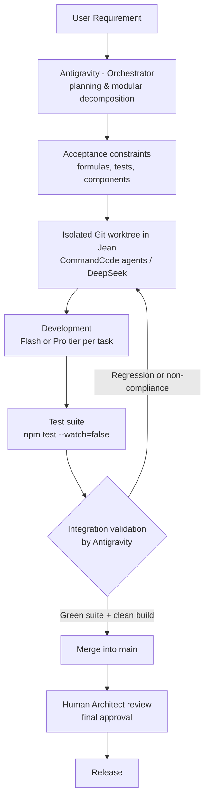

[🇮🇹 Versione Italiana](AGENT.it.md)

# Supervised Agentic Workflow & Engineering Architecture

This document describes how **HeroForge-Anew-Angular** is planned, implemented and verified. It is
the companion to the [README](README.md): the README explains *what* the project is, this document
explains *how* it is built.

---

## 1. Foundational Philosophy: Supervised AI Coding vs Vibe Coding

**Vibe coding** means describing an outcome to a model, accepting the generated code because it
*looks* plausible, and shipping it. It optimises for speed of output. It does not optimise for
correctness, and it cannot tell the difference between "this works" and "this reads as if it works".

That distinction is fatal for a project like a D&D 3.5 rules engine. Three failure modes are
structural, not occasional:

- **Lack of verifiability.** There is no compiler or type system that can confirm "the Base Attack
  Bonus for a good progression at level 12 is +12". Correctness lives in the *rules*, and only an
  explicit oracle — the source spreadsheet and the SRD — can confirm it.
- **Mathematical hallucinations.** A model can confidently emit a plausible but wrong formula (an
  off-by-one in the point-buy cost table, a wrong carrying-capacity multiplier, an incorrect
  experience curve). The output is fluent and the numbers are wrong — the worst possible combination
  because it survives casual review.
- **Silent regressions.** A fix for one class feature can quietly break a shared calculation used by
  twenty others. Without a regression suite, the break is invisible until a user notices a wrong
  number on a character sheet.

**Supervised AI Coding** is the opposite discipline. AI writes the code, but the process around it is
engineered:

- **An explicit oracle.** Every rule is checked against the original HeroForge Anew formulas and the
  D&D 3.5 SRD, and encoded as an automated test. The formulas are the specification.
- **A formal test suite.** The compliance suite
  (`frontend/src/app/core/services/character-rules-excel-compliance.spec.ts`) pins the expected
  values — point-buy cost table, the `L * (L - 1) / 2 * 1000` experience table, BAB progressions,
  base save formulas and more — so correctness is machine-checked, not eyeballed.
- **Review, not acceptance.** Generated code is reviewed against the constraints before it enters
  `main`. "It looks fine" is not an acceptance criterion; "the suite is green and the build is clean"
  is.

The result is that the AI accelerates execution while humans keep judgement, and every number on the
character sheet is traceable to a formula that a test protects.

---

## 2. The Triadic Agentic Architecture

The work is delivered by three roles with clearly separated responsibilities:

### Human Architect

- Strategic direction and business requirements.
- Definition of what "done" means for the product.
- Final validation and approval. The Human Architect owns accountability.

### Antigravity (Google DeepMind) — Orchestrator & Supervisor

- Architectural planning and **modular decomposition** of work into independently deliverable tasks.
- Definition of **acceptance constraints** for each task (which formulas, which components, which
  tests).
- Supervision of the **test and integration** discipline: verifying that the suite is green and that
  changes respect the Excel/SRD compliance rules before anything is integrated.
- Owns the "is this the right structure?" question across the whole system.

### Jean (Collabsio) — Distributed Agentic Execution Engine

- Executes tasks as **CommandCode agents in isolated Git worktrees**, so parallel workstreams never
  collide on the same working tree.
- Runs on **DeepSeek** models with tiering:
  - **Flash tier** for well-scoped, bounded tasks — documentation, small features, mechanical edits.
  - **Pro tier** for architectural refactors, cross-cutting changes and rule-engine work where deeper
    reasoning is required.
- Produces changes on a branch and hands them back for validation; it never self-approves a merge.

---

## 3. Workflow Diagram

The full cycle, from a user requirement to a merged change, is:

The loop back from validation to the worktree is deliberate: a failing test or a compliance
violation sends the change back to development. Nothing reaches `main` on a red suite.

---

## 4. Engineering Standards and Agent Guidelines

These are binding rules for every agent working on this repository.

### Branch isolation — never work on `main`

- All work happens on a dedicated branch (e.g. `docs/readme-and-agent`, `feat/...`, `fix/...`).
- `main` is only updated through a reviewed merge. Never commit directly to `main`.

### Test-Driven and Excel compliance

- Every calculation must respect the formulas of the original HeroForge Anew spreadsheet and the D&D
  3.5 SRD. New rule logic is written test-first where practical.
- The compliance suite is the oracle for numerical behaviour; changing a formula means changing its
  test with justification, not deleting it.

### Zero-regression policy

- `npm test -- --watch=false` must report **100% pass — all 130 tests** — before any commit.
- A red suite is a blocking condition, not a warning. Fix the regression; do not skip or disable the
  test.

### Clean build

- `npm run build` must complete without errors before a change is considered deliverable.
- A change that breaks the production build is not mergeable, regardless of test status.

### Scope discipline

- Change only what the task requires. Do not refactor unrelated code, add speculative abstractions, or
  introduce configuration for hypothetical future needs.
